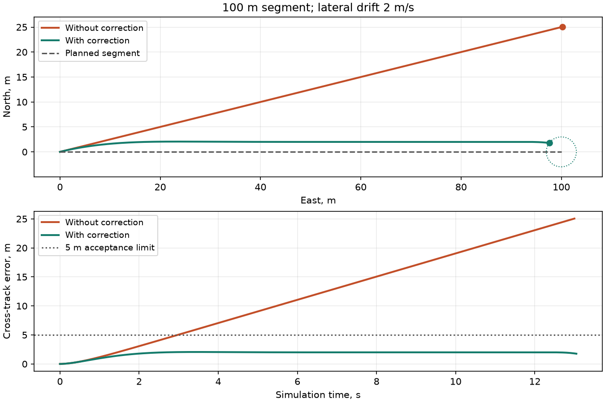

# D1 — замкнений прогін одного відрізка

Дата: 2026-11-23. Середовище й версії — [environment.txt](environment.txt); команди, вивід збірки та тестів — [checks.txt](checks.txt).

Із кореня репозиторію:

```sh
cmake -S . -B build
cmake --build build -j 4
ctest --test-dir build --output-on-failure
./build/kpi4_demo --output devlogs/manual/D1-guidance-demo
```

Вхід: фіксований східний відрізок 100 м від 50° N, 30° E, швидкість 8 м/с, межа команди 12 м/с. Боковий знос +2 м/с на північ; крок 0,05 с, час відгуку виконавця 0,5 с, початкова швидкість нульова. Випередження `max(5 м, |v_ground| · 1 с)` з обмеженням довжиною відрізка. Вимірювання без шуму/затримки, `seed=none`. [Формули й межі моделі](../../../docs/guidance-demo.md).

Заздалегідь задані очікування: із корекцією відстань до цілі ≤3 м, максимальне поперечне відхилення ≤5 м; обидві похибки менші за базу за того самого збурення. Обидва прогони завершуються при досягненні точки або перетині кінцевої площини, з обмеженням часу 30 с.

| Режим | Ціль досягнуто | Час, с | Максимальне відхилення, м | Фінальна відстань, м |
| --- | --- | --- | --- | --- |
| Без корекції | Ні, перетнуто кінцеву площину | 13,00 | 25,049 | 25,050 |
| Із корекцією | Так | 13,05 | 2,059 | 2,933 |

Фактичний результат: `PASS`, exit 0, stderr порожній. Усі 5 наборів CTest пройшли. Нові перевірки охоплюють геометрію, відмови, обмеження швидкості, знос ±2 м/с, відсутність зносу та побайтову повторюваність CSV.



Збережено [базову траєкторію](baseline.csv), [траєкторію з корекцією](corrected.csv), [точні метрики](summary.csv), [stdout](stdout.txt) та [stderr](stderr.txt). [SVG графіка](trajectory.svg) відтворюється командою `python3 devlogs/manual/D1-guidance-demo/plot.py` за наявності Matplotlib; для збірки й самого демо Matplotlib не потрібен.

Результат підтверджує корекцію в умовному горизонтальному контурі. Він не підтверджує фізичну сумісність контролера або утримання точки після завершення запису. Кілька waypoint і збої вимірювань перевірятимуться наступним кроком.
