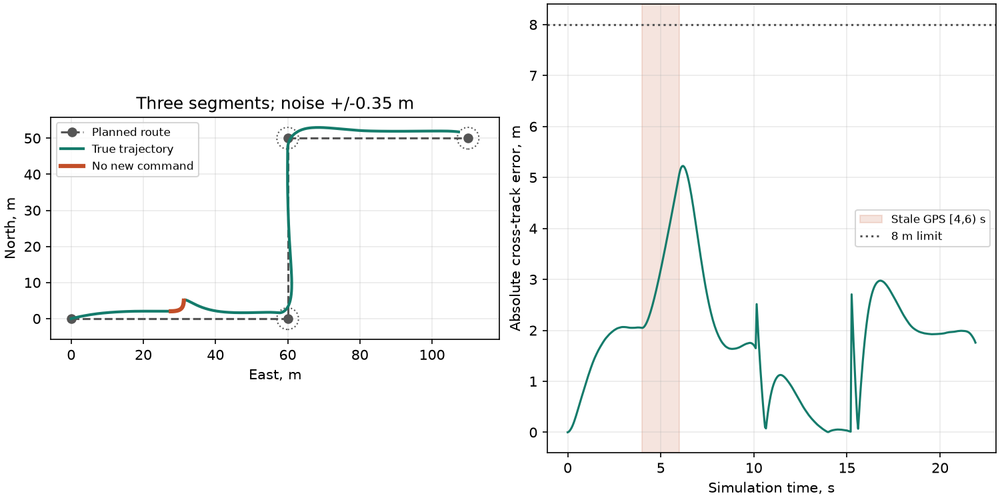

# D2 — маршрут і відмови GPS

Дата: 2026-11-24, Europe/Kiev. [Середовище](environment.txt), [збірка й тести](checks.txt), [команди та stdout усіх сценаріїв](runs.txt), [точні метрики](scenarios.csv).

Відтворення основного прогону з кореня репозиторію:

```sh
cmake -S . -B build
cmake --build build -j 4
ctest --test-dir build --output-on-failure
./build/kpi4_demo --scenario route --noise 0.35 --fault stale --output build/route
```

План E/N: (0,0)→(60,0)→(60,50)→(110,50) м від 50° N, 30° E. Знос 2 м/с на північ; dt=0,05 с, τ=0,5 с, межа команди 12 м/с, seed42. До прогонів задано: 3 досягнуті цілі за ≤60 с; радіус за вимірюванням 3 м, істинна відстань при переході ≤4 м, maxCTE≤max(8 м,|offset|+2 м). На [4,6) с — 40 непридатних/відсутніх зразків без нових команд і без просування маршруту, потім відновлення. [Параметри й модель](../../../docs/route-demo.md).

| Сценарій | Час, с | Max CTE, м | Max істинна відстань при досягненні, м | Непридатні / відсутні зразки |
| --- | --- | --- | --- | --- |
| Номінальний, 8 м/с | 19,70 | 2,939 | 2,863 | 0 / 0 |
| Шум ±0,35 м | 19,75 | 3,009 | 2,893 | 0 / 0 |
| 6 м/с, offset −6 м, шум | 26,00 | 6,000 | 3,154 | 0 / 0 |
| 10 м/с, offset +6 м, шум | 16,35 | 6,000 | 2,957 | 0 / 0 |
| Прострочений GPS, шум | 21,90 | 5,226 | 3,172 | 40 / 0 |
| Відсутній GPS, шум | 21,90 | 5,226 | 3,172 | 0 / 40 |
| GPS no_fix, шум | 21,90 | 5,226 | 3,172 | 40 / 0 |

Усі сценарії: `PASS`, exit 0, 3/3 цілі. За однакової політики нульової цілі під час відмови три типи втрати даних дають однаковий істинний рух, але різні причини в журналі. Прогін із шумом показує, чому виміряний радіус 3 м не дорівнює гарантії істинної відстані ≤3 м.



Збережено повний [route.csv](route.csv) лише для основного сценарію `stale`, [waypoints.csv](waypoints.csv), [summary.csv](summary.csv), [stdout](stdout.txt) і порожній [stderr](stderr.txt). Для інших сценаріїв достатньо метрик і команд у `scenarios.csv`/`runs.txt`. Графік відтворюється через `python3 devlogs/manual/D2-route-demo/plot.py` за наявності Matplotlib; демо й тести його не потребують.

Усі 6 наборів CTest пройшли. Перевірено переходи без порожнього командного циклу, завершення без цілі, повернення до пропущеної точки, відмову всьому невалідному маршруту до руху, знаки/межі, різні швидкості, seed-повторюваність, придушення команд і відновлення після кожного fault. Старий ігнорований `build/` з C++ тестовими бінарниками та пробними результатами видалено й перескладено; попередні ручні журнали залишено.

Це умовна горизонтальна модель. Поведінка реального контролера при втраті даних, MAVLink-вихід і завантаження маршруту з GCS ще не перевірені.
